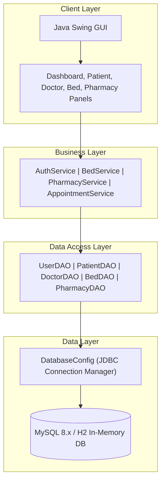
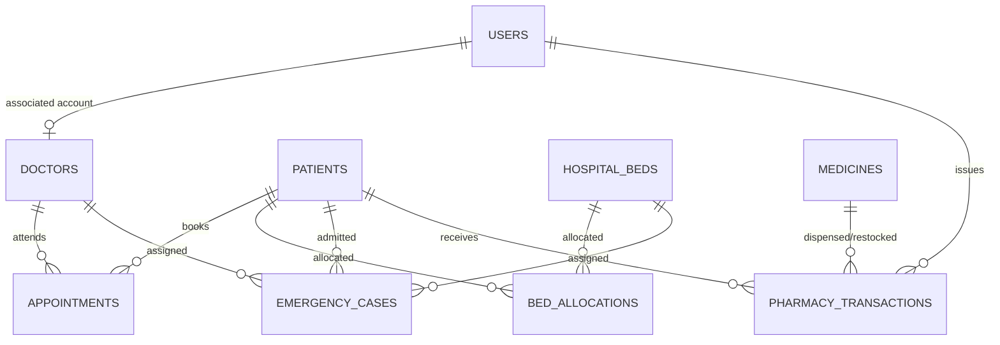

# Smart Hospital Management System
> **Database-Driven Real-Time Desktop Application with Java Swing GUI Integration**
> 
> *DBMS College Practical Assignment & Demonstration Case Study*

---

## 📌 Project Overview
The **Smart Hospital Management System (SHMS)** is a full-featured desktop application designed to streamline core hospital operations, including patient registration, doctor directory scheduling, appointment booking, hospital bed availability allocation, emergency triage management, and pharmacy inventory control.

The system connects a modern **Java Swing GUI** to a **MySQL 8.x relational database** (with automatic fallback to an embedded **H2 database** for offline execution), implementing atomic transactions, BCrypt security, and real-time periodic database polling.

---

## 🎯 Problem Statement
In traditional hospital administrative workflows:
- Concurrent requests for hospital beds lead to double allocations.
- Doctor consultation schedules suffer from double-booking conflicts.
- Pharmacy stock drops below critical levels without real-time alerting.
- Patient medical visit logs are fragmented across manual registers.

SHMS solves these challenges by providing a normalized database with atomic transactions, validation rules, and automated dashboard polling.

---

## ✨ Key Features
- **🔑 Role-Based Access Control (RBAC):** Authenticated access for `ADMIN`, `DOCTOR`, and `STAFF` with BCrypt password hashing.
- **👨‍⚕️ Doctor Directory & Availability:** Real-time tracking of doctor specializations and status (`AVAILABLE`, `ON_LEAVE`, `BUSY`, `OFF_DUTY`).
- **📅 Appointment Scheduling:** Book consultation slots with automated doctor availability and double-booking conflict prevention.
- **🛏️ Bed Management & Atomic Allocation:** Interactive bed grid with transactional row-level locking (`FOR UPDATE`) preventing double allocation.
- **🚨 Emergency Intake & Triage:** Emergency case tracking sorted by triage priority (`CRITICAL`, `HIGH`, `MEDIUM`, `LOW`).
- **💊 Pharmacy Inventory & Transactions:** Stock maintenance with non-negative stock enforcement and soft red highlighting for low-stock items.
- **📊 Real-time Dashboard Polling:** Asynchronous 5-second database polling refreshes KPI metrics without GUI freezing.
- **📈 Analytical DBMS Query Reports:** Embedded execution viewer for SQL JOINs, GROUP BY aggregations, and subqueries.

---

## 🛠️ Technology Stack
- **Language:** Java 21+
- **GUI Framework:** Java Swing (FlatLaf / System Look & Feel)
- **Database Engine:** MySQL 8.x / H2 Database (In-Memory Fallback)
- **Database Driver:** JDBC with MySQL Connector/J 8.3.0
- **Security:** BCrypt Password Hashing (`jbcrypt`)
- **Build & Dependency Tool:** Apache Maven 3.9+
- **Testing Framework:** JUnit 5

---

## 📂 Project Structure

```text
smart-hospital-management-system/
├── README.md
├── pom.xml
├── .gitignore
├── LICENSE
├── .env.example
├── docs/
│   ├── DBMS_PRACTICAL_MANUAL.md
│   ├── requirements.md
│   ├── architecture.md
│   ├── database-design.md
│   ├── er-diagram.md
│   ├── testing-report.md
│   ├── sample-outputs.md
│   └── screenshots.md
├── database/
│   ├── 01_create_database.sql
│   ├── 02_create_tables.sql
│   ├── 03_sample_data.sql
│   └── 04_reports_and_queries.sql
└── src/
    ├── main/
    │   ├── java/com/hospital/
    │   │   ├── Main.java
    │   │   ├── config/
    │   │   │   └── DatabaseConfig.java
    │   │   ├── model/
    │   │   │   ├── User.java
    │   │   │   ├── Patient.java
    │   │   │   ├── Doctor.java
    │   │   │   ├── Appointment.java
    │   │   │   ├── HospitalBed.java
    │   │   │   ├── BedAllocation.java
    │   │   │   ├── EmergencyCase.java
    │   │   │   ├── Medicine.java
    │   │   │   ├── PharmacyTransaction.java
    │   │   │   └── DashboardStats.java
    │   │   ├── dao/
    │   │   │   ├── UserDAO.java
    │   │   │   ├── PatientDAO.java
    │   │   │   ├── DoctorDAO.java
    │   │   │   ├── AppointmentDAO.java
    │   │   │   ├── BedDAO.java
    │   │   │   ├── EmergencyDAO.java
    │   │   │   ├── PharmacyDAO.java
    │   │   │   └── DashboardDAO.java
    │   │   ├── service/
    │   │   │   ├── AuthService.java
    │   │   │   ├── PatientService.java
    │   │   │   ├── DoctorService.java
    │   │   │   ├── AppointmentService.java
    │   │   │   ├── BedService.java
    │   │   │   ├── EmergencyService.java
    │   │   │   ├── PharmacyService.java
    │   │   │   └── DashboardService.java
    │   │   ├── ui/
    │   │   │   ├── LoginDialog.java
    │   │   │   ├── MainDashboardFrame.java
    │   │   │   ├── DashboardPanel.java
    │   │   │   ├── PatientPanel.java
    │   │   │   ├── DoctorPanel.java
    │   │   │   ├── AppointmentPanel.java
    │   │   │   ├── BedPanel.java
    │   │   │   ├── EmergencyPanel.java
    │   │   │   ├── PharmacyPanel.java
    │   │   │   └── ReportsPanel.java
    │   │   └── util/
    │   │       ├── PasswordUtil.java
    │   │       └── ValidationUtil.java
    │   └── resources/
    └── test/
        └── java/com/hospital/
            ├── PasswordUtilTest.java
            ├── ValidationUtilTest.java
            ├── AppointmentServiceTest.java
            └── PharmacyServiceTest.java
```

---

## 🏗️ Architecture Diagram



---

## 📐 ER Diagram



---

## ⚙️ Prerequisites & Setup

### 1. Prerequisites
- **Java Development Kit (JDK 21+):** Verify with `java -version`.
- **Apache Maven 3.9+:** Verify with `mvn -version`.
- **MySQL 8.x Server (Optional):** If MySQL is not running, the application automatically defaults to an in-memory **H2 database** pre-seeded with sample data.

---

### 2. Database Setup (MySQL)
Run the SQL scripts in order using MySQL Workbench or Command Line:
```bash
mysql -u root -p < database/01_create_database.sql
mysql -u root -p smart_hospital_db < database/02_create_tables.sql
mysql -u root -p smart_hospital_db < database/03_sample_data.sql
mysql -u root -p smart_hospital_db < database/04_reports_and_queries.sql
```

---

### 3. Environment Configuration
Copy `.env.example` to `.env` or set environment variables:
```env
DB_HOST=localhost
DB_PORT=3306
DB_NAME=smart_hospital_db
DB_USER=root
DB_PASSWORD=your_mysql_password
```

---

## 🚀 Build and Run Instructions

### Compile the Project
```bash
mvn clean compile
```

### Run Unit Tests
```bash
mvn test
```

### Package the Application (Executable Fat JAR)
```bash
mvn package
```

### Launch the Application
```bash
java -jar target/smart-hospital-management-system-1.0.0.jar
```

---

## 🔑 Default Credentials for Testing
- **Admin User:** `admin` / `admin123`
- **Doctor User:** `dr_john` / `doctor123`
- **Staff User:** `staff_mary` / `staff123`

---

## 📤 Publishing to GitHub
To publish this repository to your GitHub account:

```bash
git init
git add .
git commit -m "Initial commit: Smart Hospital Management System"
git branch -M main
git remote add origin YOUR_GITHUB_REPOSITORY_URL
git push -u origin main
```
> **Note:** Replace `YOUR_GITHUB_REPOSITORY_URL` with your actual remote GitHub repository URL.

---

## 📄 License
This project is licensed under the [MIT License](LICENSE). Educational demonstration software for DBMS college assignments.
