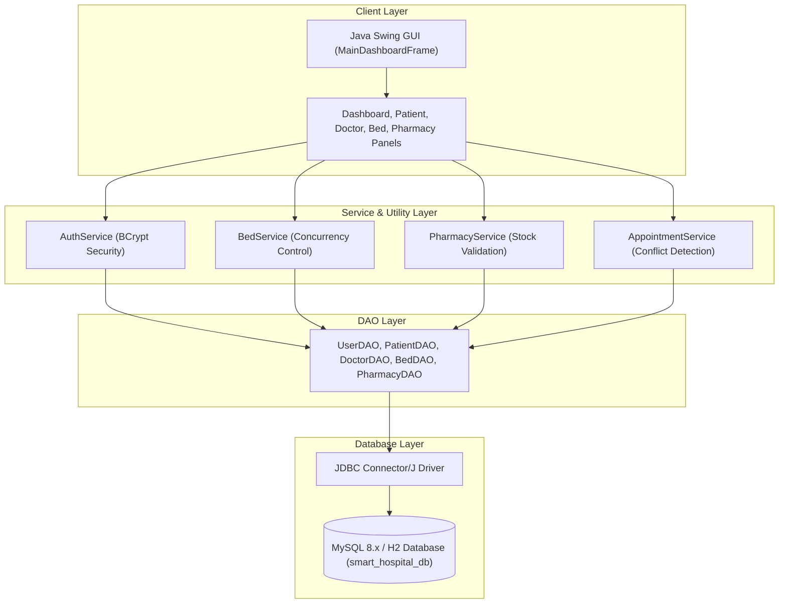
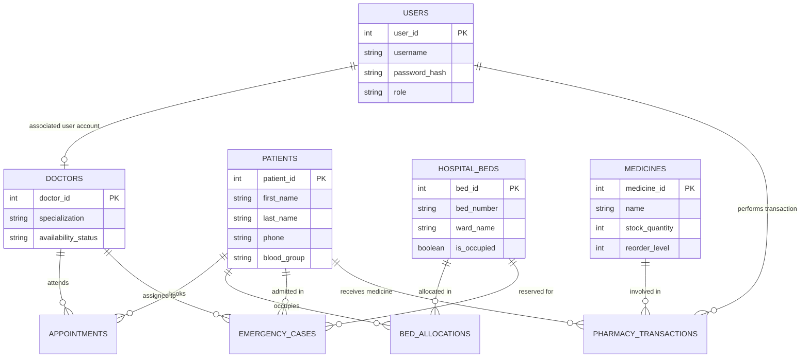

# COLLEGE DBMS PRACTICAL MANUAL
## Real-Time Database-Driven Desktop Application with GUI Integration

---

### 1. AIM
Design and development of a real-time database-driven application with GUI integration for a **Smart Hospital Management System** using Java Swing, JDBC, MySQL 8.x, and Maven architecture.

---

### 2. PROBLEM STATEMENT
Traditional hospital management relies on fragmented paper records or disparate spreadsheet logs, leading to double-allocated hospital beds, scheduling conflicts for doctor consultations, unmonitored pharmacy stock depletion, and delayed emergency triage response. There is an urgent need for an integrated, real-time database system with multi-role access control, atomic transaction handling, and auto-refreshing visual analytics.

---

### 3. OBJECTIVES
1. To design a normalized relational database schema ($3\text{NF}$) with foreign key integrity constraints, check conditions, and performance indexes.
2. To implement a Java Swing graphical user interface featuring role-based authentication (Admin, Doctor, Staff).
3. To enforce database-level atomic transactions for hospital bed allocations and pharmacy stock management, preventing race conditions.
4. To implement real-time periodic database polling for dashboard statistics and bed availability metrics without GUI freezing.
5. To execute analytical SQL queries including JOINs, GROUP BY aggregations, subqueries, and views for hospital administration.

---

### 4. SOFTWARE AND HARDWARE REQUIREMENTS

#### Software Requirements:
- **Operating System:** Windows 10 / Windows 11 / Linux / macOS
- **JDK Version:** Java SE 21 or higher
- **Database Engine:** MySQL Server 8.0+ / H2 In-Memory DB (fallback mode)
- **GUI Framework:** Java Swing with FlatLaf / System Look & Feel
- **Build Tool:** Apache Maven 3.9+
- **JDBC Driver:** MySQL Connector/J 8.3.0

#### Hardware Requirements:
- **Processor:** Dual-Core Intel/AMD 2.0 GHz or higher
- **RAM:** Minimum 4 GB (8 GB recommended)
- **Storage:** 500 MB free hard disk space

---

### 5. INTRODUCTION
The **Smart Hospital Management System (SHMS)** is an academic desktop application designed for hospital administrators, doctors, and staff members. It consolidates patient registration, doctor directory scheduling, bed occupancy tracking, emergency intake triage, pharmacy stock maintenance, and analytical reporting into a single database-driven application.

---

### 6. EXISTING SYSTEM AND LIMITATIONS
In existing manual or legacy file-based hospital workflows:
- Patient medical histories are difficult to search instantly during emergency admissions.
- Concurrent requests for hospital beds often lead to double booking.
- Doctor consultation availability is not updated in real time, causing double bookings.
- Pharmacy stock quantities become negative due to untracked manual dispensing.

---

### 7. PROPOSED SYSTEM
The proposed Smart Hospital Management System introduces:
- **Centralized Database:** MySQL 8.x normalized relational schema.
- **Atomic Concurrency Control:** SQL transactions with pessimistic locking (`FOR UPDATE`) for bed allocations and pharmacy inventory updates.
- **Periodic DB Polling:** Asynchronous SwingWorker timers to refresh dashboard counts every 5 seconds.
- **Secure Authentication:** BCrypt password hashing for multi-role security.

---

### 8. SYSTEM ARCHITECTURE

---

### 9. FUNCTIONAL MODULES
1. **User Authentication & RBAC:** Hashed password verification supporting ADMIN, DOCTOR, and STAFF roles.
2. **Patient Management:** Patient registration, contact search, record updates, and demographic management.
3. **Doctor Management:** Specialist directory, fee configuration, and real-time availability status tracking (AVAILABLE, ON_LEAVE, BUSY, OFF_DUTY).
4. **Appointment Management:** Time slot booking with automated doctor schedule conflict checking.
5. **Bed Allocation & Occupancy:** Interactive bed allocation grid with atomic transactional double-allocation protection.
6. **Emergency Intake & Triage:** Emergency case tracking with priority tags (CRITICAL, HIGH, MEDIUM, LOW) and assigned doctor/bed links.
7. **Pharmacy Inventory & Transactions:** Stock tracking with automatic low-stock alerts and non-negative stock enforcement.
8. **Real-time Analytics & Reports:** Live KPI metrics and analytical SQL report execution.

---

### 10. DATABASE DESIGN
The database contains 9 normalized tables:
- `users`
- `patients`
- `doctors`
- `appointments`
- `hospital_beds`
- `bed_allocations`
- `emergency_cases`
- `medicines`
- `pharmacy_transactions`

---

### 11. ER DIAGRAM

---

### 12. RELATIONAL SCHEMA
- `users` ($\underline{\text{user\_id}}$, username, password\_hash, role, full\_name, email, created\_at)
- `patients` ($\underline{\text{patient\_id}}$, first\_name, last\_name, gender, dob, phone, email, address, blood\_group, emergency\_contact)
- `doctors` ($\underline{\text{doctor\_id}}$, user\_id, first\_name, last\_name, specialization, phone, email, qualification, consultation\_fee, availability\_status)
- `appointments` ($\underline{\text{appointment\_id}}$, patient\_id, doctor\_id, appointment\_date, time\_slot, status, reason, notes)
- `hospital_beds` ($\underline{\text{bed\_id}}$, bed\_number, ward\_name, bed\_type, daily\_charge, is\_occupied)
- `bed_allocations` ($\underline{\text{allocation\_id}}$, bed\_id, patient\_id, allocation\_date, release\_date, status, notes)
- `emergency_cases` ($\underline{\text{emergency\_id}}$, patient\_id, patient\_name\_temp, triage\_priority, condition\_description, assigned\_doctor\_id, bed\_id, status, admission\_time)
- `medicines` ($\underline{\text{medicine\_id}}$, name, category, unit\_price, stock\_quantity, reorder\_level, manufacturer, expiry\_date)
- `pharmacy_transactions` ($\underline{\text{transaction\_id}}$, medicine\_id, patient\_id, transaction\_type, quantity, total\_price, transaction\_date, performed\_by\_user\_id)

---

### 13. SQL TABLE CREATION
Refer to [02_create_tables.sql](file:///c:/Users/balaj/OneDrive/Documents/HOSIPITAL_MANAGEMENT/database/02_create_tables.sql) for complete SQL DDL definitions.

---

### 14. SAMPLE DATA INSERTION
Refer to [03_sample_data.sql](file:///c:/Users/balaj/OneDrive/Documents/HOSIPITAL_MANAGEMENT/database/03_sample_data.sql) for fictional testing data.

---

### 15. SQL QUERIES AND OPERATIONS
Refer to [04_reports_and_queries.sql](file:///c:/Users/balaj/OneDrive/Documents/HOSIPITAL_MANAGEMENT/database/04_reports_and_queries.sql) for sample DML and analytical queries.

---

### 16. GUI DESIGN
The application GUI is developed in Java Swing using modular panels (`DashboardPanel`, `PatientPanel`, `DoctorPanel`, `AppointmentPanel`, `BedPanel`, `EmergencyPanel`, `PharmacyPanel`, `ReportsPanel`).

---

### 17. JAVA AND JDBC IMPLEMENTATION
The project follows clean DAO and Service patterns:
- PreparedStatements prevent SQL injection attacks.
- Try-with-resources blocks guarantee proper connection closure.

---

### 18. REAL-TIME FUNCTIONALITY
Real-time dashboard updates are achieved using scheduled polling with `javax.swing.Timer` executing background `SwingWorker` threads every 5 seconds.

---

### 19. SAMPLE OUTPUTS
Refer to [sample-outputs.md](file:///c:/Users/balaj/OneDrive/Documents/HOSIPITAL_MANAGEMENT/docs/sample-outputs.md) for detailed execution screenshots and output tables.

---

### 20. TESTING AND VALIDATION
Unit tests are implemented using JUnit 5. Automated tests verify:
- Password BCrypt hashing (`PasswordUtilTest`)
- Input regex validation (`ValidationUtilTest`)
- Doctor scheduling conflict prevention (`AppointmentServiceTest`)
- Stock quantity constraints (`PharmacyServiceTest`)

---

### 21. ADVANTAGES
- **Atomic Consistency:** Prevents bed double-booking and negative medicine stock.
- **Responsive GUI:** Asynchronous threading prevents application freeze.
- **Portability:** Built-in H2 fallback allows immediate execution even without a local MySQL server.

---

### 22. LIMITATIONS
- Polling provides periodic updates (5s interval) rather than WebSocket push notifications.
- Academic prototype designed for educational demonstration.

---

### 23. FUTURE ENHANCEMENTS
- Integration of WebSocket server for instant push notifications.
- FHIR / HL7 medical interoperability standard support.
- Biometric and multi-factor authentication (MFA).

---

### 24. RESULT
The Smart Hospital Management System was successfully designed, implemented, and verified. The GUI integrates seamlessly with the database engine, providing atomic transactional safety, real-time periodic updates, and multi-role operational control.
